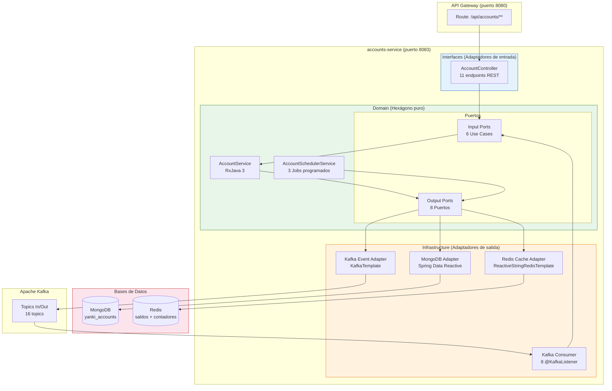
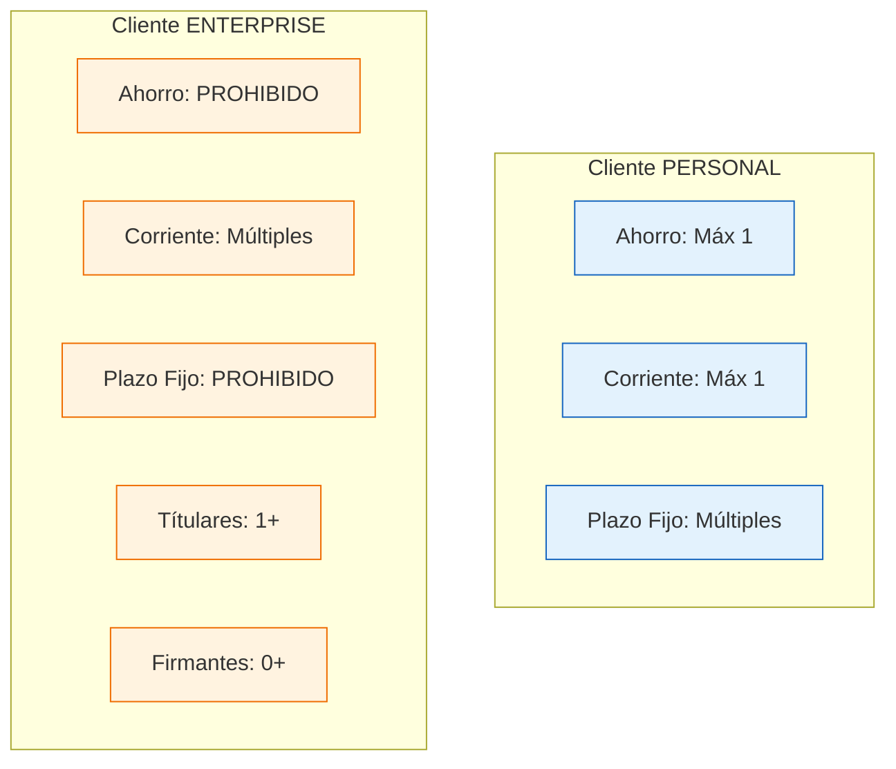
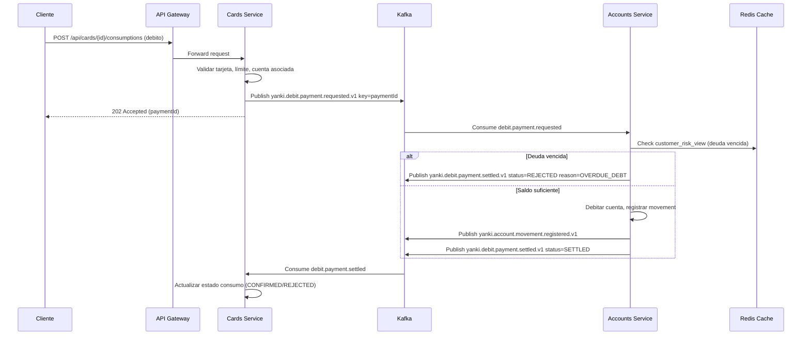

# accounts-service

> **📌 FUENTE CANÓNICA PARA HUMANOS — Lógica de negocio de accounts-service**
>
> Este `README.md` es el documento de referencia **definitivo para humanos** sobre la lógica de negocio, las reglas, los endpoints, el modelo de datos y la arquitectura del microservicio `accounts-service`.
>
> Para **agentes de IA**, consultar [`AGENTS.md`](./AGENTS.md) en la misma carpeta.
>
> Los archivos de la raíz del repositorio (`AGENTS.md`, `README.md`, `Proyecto General vf.md`) contienen reglas de oro de plataforma, índice del monorepo y requisitos generales compartidos — **no** la lógica de negocio específica de este servicio.

Microservicio de **cuentas bancarias** (productos pasivos) de la plataforma bancaria **Yanki**.

Gestiona los productos de ahorro, corriente y plazo fijo, incluyendo movimientos, comisiones, intereses y liquidaciones de pagos débito y transferencias.

- **Puerto:** `8083`
- **Base de datos propia:** MongoDB `yanki_accounts` (colecciones: `accounts`, `movements`, `customer_profile_view`, `customer_card_view`, `customer_risk_view`)
- **Cache:** Redis (saldos de cuentas TTL 5m)
- **Stack:** Java 17, Spring Boot 3.3.5, Spring WebFlux, Spring Data Reactive (MongoDB + Redis), RxJava 3, Spring Kafka, springdoc-openapi
- **Estado:** ✅ Completamente implementado — CRUD completo, operaciones, comisiones, eventos Kafka, vistas locales, 106 tests
- **Author:** Sebastian Retamal (semorale@emeal.nttdata.com)

---

## 1. Propósito

| Responsabilidad | Detalle |
|---|---|
| Apertura de cuentas | Crea cuentas de ahorro, corriente y plazo fijo con validaciones de negocio |
| Movimientos | Depósitos, retiros, transferencias, comisiones, intereses, pagos débito |
| Liquidaciones | Liquida pagos con tarjeta débito (cards) y transferencias (transfers) |
| Comisiones e intereses | Aplica comisiones de mantenimiento, exceso de movimientos, intereses plazo fijo |
| Vistas locales | Mantiene proyecciones de cliente (perfil, tarjetas, riesgo) via eventos Kafka |
| Eventos | Publica apertura, cierre, movimientos, liquidaciones débito/transferencia |

---

## 0. Auditoría de Seguridad y Código

> **Fecha:** 2026-11-21 | **Estado:** ⚠️ 4 CRÍTICOS, 5 ALTO, 4 MEDIO, 3 BAJO
>
> Consulte [`AUDIT_REPORT.md`](./AUDIT_REPORT.md) para el reporte completo con hallazgos, fragmentos de código y propuestas de corrección.

### Diagrama de Arquitectura



---

## 1. Auditoría de Arquitectura Hexagonal

> **Fecha:** 2026-11-14 | **Estado:** ✅ Sin violaciones | **Última verificación:** 2026-11-14

### Resumen Ejecutivo

El `accounts-service` cumple con el estándar de Arquitectura Hexagonal definido en `system-prompt-auditoria-hexagonal-yanki.md`. Las violaciones detectadas en versiones anteriores han sido **refactorizadas y corregidas**. El dominio está completamente aislado de infraestructura.

### Verificación de Cumplimiento

| Verificación | Resultado | Detalle |
|-------------|-----------|---------|
| `domain/model` sin `@Document`/`@Id` | ✅ Cero violaciones | Entidades puras: `Account.java`, `Movement.java` sin anotaciones MongoDB |
| `domain/service` sin imports de `infrastructure` | ✅ Cero violaciones | `AccountService` importa solo puertos y modelos |
| `domain/service` sin Spring Data/Kafka/Web | ✅ Cero violaciones | Sin imports de `org.springframework.data`, `kafka`, `web` |
| `domain/service` sin Reactor (Mono/Flux) | ✅ Cero violaciones | RxJava 3 puro: `Single`, `Maybe`, `Completable`, `Flowable` |
| Puertos de salida (`domain/port/out`) | ✅ 8 puertos implementados | `AccountPersistencePort`, `MovementPersistencePort`, `CachePort`, `EventPublisherPort`, `IdempotencyPort`, `ProfileViewPort`, `CardViewPort`, `RiskViewPort` |
| Adaptadores (`infrastructure/adapter`) | ✅ Implementados | `AccountMongoAdapter`, `MovementMongoAdapter`, `RedisCacheAdapter`, `KafkaEventAdapter`, `IdempotencyAdapter` |
| Puertos de entrada (`domain/port/in`) | ✅ 6 use cases implementados | `OpenAccountUseCase`, `DepositUseCase`, `WithdrawUseCase`, `CloseAccountUseCase`, `SettleDebitPaymentUseCase`, `SettleTransferUseCase` |
| Sin `.block()`, `.blockingGet()`, `.blockingFirst()` | ✅ Cero violaciones | Reactividad 100% no bloqueante |
| Kafka consumer idempotente | ✅ Implementado | `processed_events` con clave única por topic+entityId+occurredAt |
| Documentación MongoDB en `infrastructure` | ✅ Correcto | `AccountDocument`, `MovementDocument` con `@Document`/`@Id` en capa de infraestructura |
| Mappers Document ↔ Entity | ✅ Correcto | `AccountMapper`, `MovementMapper` en `infrastructure/persistence/mapper` |

### Lo que está bien implementado

| Aspecto | Estado | Detalle |
|---------|--------|---------|
| ✅ Estructura de paquetes | Correcta | `domain`, `infrastructure`, `interfaces.rest` |
| ✅ Entidades puras de dominio | Correcto | Sin anotaciones de infraestructura en `domain/model` |
| ✅ Puertos y adaptadores | Correcto | Separación clara entre puertos (domain) y adaptadores (infrastructure) |
| ✅ Eventos de dominio | Correcto | Records inmutables en `domain/event/` |
| ✅ Excepciones de negocio | Correcto | `BusinessException` y `ErrorCodes` en domain |
| ✅ Patrón Strategy | Correcto | Filtros de cuentas y movimientos con Strategy |
| ✅ Commands y Results | Correcto | `OpenAccountCommand`, `DepositCommand`, etc. |
| ✅ Controlador REST | Correcto | Solo invoca puertos de entrada |
| ✅ GlobalExceptionHandler | Correcto | Mapea `BusinessException` → `ApiError` |
| ✅ Kafka Consumer | Correcto | Idempotencia con `processed_events` |
| ✅ Kafka Publisher | Correcto | 5 topics outbound con RxJava |
| ✅ DTOs | Correcto | Separados en `interfaces/rest/dto/` |
| ✅ Tests | Completo | **106 tests unitarios**, 0 fallos, 0 errores |

### Historial de Refactorización

| Fecha | Acción | Resultado |
|-------|--------|-----------|
| 2026-11-14 | Entidades puras | `Account.java`, `Movement.java` sin `@Document`/`@Id` |
| 2026-11-14 | Puertos de salida | 8 puertos creados en `domain/port/out` |
| 2026-11-14 | Adaptadores MongoDB | `AccountMongoAdapter`, `MovementMongoAdapter` con mappers |
| 2026-11-14 | Adaptador Redis | `RedisCacheAdapter` implementa `CachePort` |
| 2026-11-14 | Adaptador Kafka | `KafkaEventAdapter` implementa `EventPublisherPort` |
| 2026-11-14 | Puertos de entrada | 6 use cases en `domain/port/in` |
| 2026-11-14 | AccountService puro | Inyecta solo puertos, sin infraestructura directa |
| 2026-11-14 | APIs RxJava 3 | Corregido `Maybe.toSingle()`, `Single.toCompletable()`, `flatMapObservable` |
| 2026-11-14 | Tests | 106 tests pasando, cobertura domain.service ≥ 80% |

---

## 2. Endpoints REST

Base: `/api/accounts`

| Método | Ruta | Descripción | Respuesta |
|---|---|---|---|
| `POST` | `/api/accounts` | Abre una cuenta (SAVINGS/CURRENT/TERM_FIXED) | `201` `AccountResponse` |
| `GET` | `/api/accounts` | Lista cuentas (filtros: customerId, type, status) | `200` `PageResponse<AccountResponse>` |
| `GET` | `/api/accounts/{id}` | Detalle cuenta + saldo | `200` `AccountResponse` |
| `GET` | `/api/accounts/{id}/balance` | Consulta saldo (cache Redis) | `200` `BalanceResponse` |
| `GET` | `/api/accounts/{id}/movements` | Movimientos paginados | `200` `PageResponse<MovementResponse>` |
| `POST` | `/api/accounts/{id}/deposits` | Depósito en cuenta | `201` `MovementResponse` |
| `POST` | `/api/accounts/{id}/withdrawals` | Retiro de cuenta | `201` `MovementResponse` |
| `DELETE` | `/api/accounts/{id}` | Cierra cuenta (saldo = 0) | `204` |

### 2.1 Filtros y paginación de `GET /api/accounts`

| Parámetro | Tipo | Default | Descripción |
|---|---|---|---|
| `customerId` | `String` | - | Filtrar por cliente |
| `type` | `SAVINGS` \| `CURRENT` \| `TERM_FIXED` | - | Filtrar por tipo |
| `status` | `OPEN` \| `CLOSED` \| `BLOCKED` | - | Filtrar por estado |
| `page` | `int` | `0` | Número de página (base cero) |
| `size` | `int` | `20` | Elementos por página (máx `100`) |

### 2.2 Ejemplos

```bash
# Apertura cuenta ahorro (cliente PERSONAL)
curl -X POST http://localhost:8083/api/accounts \
  -H "Content-Type: application/json" \
  -H "Authorization: Bearer <token>" \
  -d '{
        "customerId": "CUST-123",
        "accountType": "SAVINGS",
        "currency": "PEN",
        "initialAmount": 100.00
      }'

# Apertura cuenta corriente empresarial
curl -X POST http://localhost:8083/api/accounts \
  -H "Content-Type: application/json" \
  -H "Authorization: Bearer <token>" \
  -d '{
        "customerId": "CUST-456",
        "accountType": "CURRENT",
        "currency": "PEN",
        "initialAmount": 500.00,
        "holders": [{"holderId": "CUST-456", "percentage": 100, "principal": true}],
        "signers": [{"signerId": "CUST-789", "operationLimit": 10000}]
      }'

# Depósito
curl -X POST http://localhost:8083/api/accounts/ACC123/deposits \
  -H "Content-Type: application/json" \
  -d '{"amount": 200, "description": "Depósito ventanilla", "channel": "BRANCH"}'

# Retiro
curl -X POST http://localhost:8083/api/accounts/ACC123/withdrawals \
  -H "Content-Type: application/json" \
  -d '{"amount": 50, "description": "Retiro ATM", "channel": "ATM"}'

# Consulta saldo (cache Redis)
curl http://localhost:8083/api/accounts/ACC123/balance

# Movimientos
curl "http://localhost:8083/api/accounts/ACC123/movements?page=0&size=20&from=2026-01-01&to=2026-12-31"

# Cierre cuenta
curl -X DELETE http://localhost:8083/api/accounts/ACC123
```

### 2.3 Errores

Todas las respuestas de error usan el mismo cuerpo:

```json
{
  "timestamp": "2026-11-04T10:15:30.123Z",
  "status": 409,
  "error": "Conflict",
  "code": "INSUFFICIENT_FUNDS",
  "message": "Saldo insuficiente",
  "path": "/api/accounts/ACC123/withdrawals",
  "details": {}
}
```

| Código | HTTP | Origen |
|---|---|---|
| `ACCOUNT_NOT_FOUND` | `404` | Cuenta no existe |
| `ACCOUNT_ALREADY_CLOSED` | `409` | Cuenta ya cerrada |
| `ACCOUNT_BLOCKED` | `403` | Cliente con deuda vencida |
| `INSUFFICIENT_FUNDS` | `400` | Saldo insuficiente |
| `SAVINGS_ACCOUNT_ALREADY_EXISTS` | `409` | Cliente PERSONAL ya tiene ahorro |
| `CURRENT_ACCOUNT_PERSONAL_LIMIT` | `409` | Cliente PERSONAL ya tiene corriente |
| `TERM_FIXED_ACCOUNT_ALREADY_EXISTS` | `409` | Cliente PERSONAL ya tiene plazo fijo |
| `ENTERPRISE_CANNOT_HAVE_SAVINGS` | `422` | ENTERPRISE no puede tener ahorro |
| `ENTERPRISE_CANNOT_HAVE_TERM_FIXED` | `422` | ENTERPRISE no puede tener plazo fijo |
| `CREDIT_CARD_REQUIRED_FOR_VIP` | `422` | VIP requiere tarjeta crédito |
| `CREDIT_CARD_REQUIRED_FOR_PYME` | `422` | PYME requiere tarjeta crédito |
| `MOVEMENT_DAY_NOT_ALLOWED` | `422` | Plazo fijo solo día permitido |
| `MOVEMENT_ALREADY_DONE_TODAY` | `409` | Ya movió hoy (plazo fijo) |
| `EXCEEDED_FREE_MOVEMENTS` | `422` | Excede movimientos gratis (ahorro) |
| `INVALID_MOVEMENT_AMOUNT` | `422` | Monto inválido |
| `CUSTOMER_HAS_OVERDUE_DEBT` | `403` | Deuda vencida bloquea operación |
| `ACCOUNT_CANNOT_CLOSE_BALANCE_NOT_ZERO` | `409` | Saldo no es 0 al cerrar |
| `VALIDATION_ERROR` | `400` | Fallo `@Valid` |
| `INVALID_INPUT` | `400` | JSON mal formado |

---

## 3. Reglas de Negocio

### 3.1 Tipos de Cuenta

| Tipo | Comisión Mantenimiento | Límite Movimientos/Mes | Restricciones |
|---|---|---|---|
| **Ahorro (SAVINGS)** | Libre (0) | Configurable (default 10) | Solo PERSONAL, máx 1 por cliente |
| **Corriente (CURRENT)** | Sí (configurable) | Sin límite | PERSONAL máx 1, ENTERPRISE múltiples |
| **Plazo Fijo (TERM_FIXED)** | Libre (0) | 1 movimiento/día específico | Solo PERSONAL, máx 1 por cliente |

### 3.2 Restricciones por Tipo de Cliente



### 3.3 Perfiles VIP / PYME (Parte II)

- **VIP (PERSONAL)**: Requiere tarjeta de crédito activa al abrir cuenta ahorro
- **PYME (ENTERPRISE)**: Requiere tarjeta de crédito activa al abrir cuenta corriente

### 3.4 Comisiones y Límites

| Concepto | Ahorro | Corriente | Plazo Fijo |
|---|---|---|---|
| Mantenimiento mensual | 0 | Configurable | 0 |
| Movimientos gratis/mes | 10 (config) | Ilimitados | 1 (día específico) |
| Comisión exceso | Por transacción | N/A | Por transacción |
| Monto mínimo apertura | 0 | 0 | 0 |

### 3.5 Plazo Fijo - Reglas Especiales

- Solo permite **1 movimiento (depósito o retiro)** en el día configurado (`allowedMovementDay`: 1-28)
- Fuera de ese día → `MOVEMENT_DAY_NOT_ALLOWED` (422)
- Si ya movió ese día → `MOVEMENT_ALREADY_DONE_TODAY` (409)

### 3.6 Bloqueo por Deuda Vencida (Parte III)

Si el cliente tiene deuda vencida > 30 días (`customer_risk_view.hasOverdueDebt = true`):
- Apertura cuenta → `CUSTOMER_HAS_OVERDUE_DEBT` (403)
- Emisión tarjeta → `CUSTOMER_HAS_OVERDUE_DEBT` (403)
- Operaciones wallet → `WALLET_BLOCKED_RISK` (403)

---

## 4. Eventos Kafka

### 4.1 Publicados (Outbound)

| Topic | Key | Payload | Trigger |
|---|---|---|---|
| `yanki.account.opened.v1` | `accountId` | `AccountOpenedEvent` | Apertura exitosa |
| `yanki.account.closed.v1` | `accountId` | `AccountClosedEvent` | Cierre exitoso |
| `yanki.account.movement.registered.v1` | `accountId` | `AccountMovementRegisteredEvent` | Cada movimiento (6 particiones) |
| `yanki.debit.payment.settled.v1` | `paymentId` | `DebitPaymentSettledEvent` | Liquidación pago débito |
| `yanki.transfer.settled.v1` | `transferId` | `TransferSettledEvent` | Liquidación transferencia |

### 4.2 Consumidos (Inbound)

| Topic | Propósito | Vista Local Actualizada |
|---|---|---|
| `yanki.customer.registered.v1` | Nuevo cliente | `customer_profile_view` |
| `yanki.customer.updated.v1` | Cambio perfil/tipo | `customer_profile_view` |
| `yanki.customer.deleted.v1` | Cliente eliminado | `customer_profile_view` (status=DELETED) |
| `yanki.card.opened.v1` | Tarjeta abierta | `customer_card_view` (hasCreditCard) |
| `yanki.card.closed.v1` | Tarjeta cerrada | `customer_card_view` |
| `yanki.debit.payment.requested.v1` | Pago débito solicitado | Validar saldo, debitar cuenta |
| `yanki.transfer.requested.v1` | Transferencia solicitada | Validar origen, debitar/acreditar |
| `yanki.credit.overdue.v1` | Deuda vencida | `customer_risk_view` (bloqueo) |

### 4.3 Publicados adicionales (Jobs)

| Topic | Key | Payload | Trigger |
|---|---|---|---|
| `yanki.account.maintenance.applied.v1` | `accountId` | `MaintenanceAppliedEvent` | Job mensual: comisión mantenimiento aplicada con éxito |
| `yanki.account.maintenance.failed.v1` | `accountId` | `MaintenanceFailedEvent` | Job mensual: saldo insuficiente para comisión |
| `yanki.vip.average.breached.v1` | `accountId` | `VipAverageBreachedEvent` | Job mensual: promedio diario VIP < mínimo |

### 4.4 Flujo Bidireccional: Pago con Tarjeta Débito



---

## 4.5 Jobs Programados (Scheduler)

| Job | Cron | Descripción |
|---|---|---|
| **vip-daily-average-check** | `0 0 2 1 * ?` (Día 1, 02:00) | Calcula promedio diario mes anterior para cuentas VIP. Si < mínimo → aplica penalidad + publica `vip.average.breached.v1` |
| **maintenance-commission** | `0 0 3 1 * ?` (Día 1, 03:00) | Aplica comisión de mantenimiento mensual a cuentas corriente STANDARD con `maintenanceCommission > 0`. Si saldo insuficiente → publica `maintenance.failed.v1` |
| **cleanup-movement-counters** | `0 0 4 1 * ?` (Día 1, 04:00) | Limpia contadores de movimientos del mes anterior en Redis (patrón `yanki:accounts:movement-count:*:{YYYY-MM-1}`) |

### Configuración de Comisiones por Tipo/Subtipo (Config Server)

| Parámetro | Ahorro STANDARD | Ahorro VIP | Corriente STANDARD | Corriente PYME | Plazo Fijo |
|---|---|---|---|---|---|
| `maxFreeMovementsMonth` | 10 | 20 | -1 (ilimitado) | -1 (ilimitado) | 1 |
| `commissionPerExcessMovement` | 2.50 | 2.50 | N/A | N/A | 5.00 |
| `maintenanceCommission` | 0 | 0 | 15.00 | **0** | 0 |
| `vipMinDailyAverage` | N/A | 5000.00 | N/A | N/A | N/A |
| `vipPenaltyAmount` | N/A | 50.00 | N/A | N/A | N/A |
| `allowedMovementDay` | N/A | N/A | N/A | N/A | 15 (1-28) |

> **Nota:** `maxFreeMovementsMonth = -1` significa **ilimitado** (sin comisión por exceso)

---

## 5. Vistas Locales (Proyecciones)

| Colección | Alimentada por | Uso |
|---|---|---|
| `customer_profile_view` | `customer.registered/updated/deleted` | Tipo/perfil cliente al abrir cuenta |
| `customer_card_view` | `card.opened/closed` | Requisito tarjeta crédito para VIP/PYME |
| `customer_risk_view` | `credit.overdue` | Bloquear productos si deuda vencida |

---

## 6. Modelo de Datos

### 6.1 Cuenta (`accounts`)

```java
@Document(collection = "accounts")
public class Account {
    @Id String id;
    String customerId;
    AccountType type;           // SAVINGS | CURRENT | TERM_FIXED
    AccountStatus status;       // OPEN | CLOSED | BLOCKED
    String currency;            // PEN | USD
    BigDecimal balance;
    BigDecimal minOpeningAmount;
    Integer maxFreeMovementsPerMonth;
    BigDecimal commissionPerExcessMovement;
    BigDecimal maintenanceCommission;
    LocalDateTime maturityDate;         // TERM_FIXED
    Integer allowedMovementDay;         // TERM_FIXED (1-28)
    List<AccountHolder> holders;        // CURRENT ENTERPRISE
    List<AccountSigner> signers;        // CURRENT ENTERPRISE
    LocalDateTime openedAt;
    LocalDateTime closedAt;
    LocalDateTime createdAt;
    LocalDateTime updatedAt;
    Integer monthlyMovementCount;
    String currentMonth;                // yyyy-MM
}
```

### 6.2 Movimiento (`movements`)

```java
@Document(collection = "movements")
public class Movement {
    @Id String id;
    String accountId;
    String customerId;
    MovementType type;         // DEPOSIT | WITHDRAWAL | TRANSFER_IN | TRANSFER_OUT | COMMISSION | INTEREST | DEBIT_PAYMENT | OPENING_DEPOSIT
    BigDecimal amount;
    BigDecimal balanceAfter;
    BigDecimal commission;
    String channel;            // BRANCH | ATM | MOBILE | WEB | AUTO
    String description;
    String referenceId;
    LocalDateTime occurredAt;
    LocalDateTime createdAt;
}
```

---

## 7. Redis Cache

| Clave | Contenido | TTL | Invalidación |
|---|---|---|---|
| `yanki:accounts:balance:{accountId}` | Saldo actual | 5m | Cada movement |
| `yanki:accounts:movement-count:{accountId}:{YYYY-MM}` | Contador mensual movimientos | Fin de mes | Cada movement, cleanup job día 1 |
| `yanki:accounts:commission-config:{accountId}` | Parámetros comisión | 1h | Actualización cuenta |

---

## 8. Variables de Entorno

| Variable | Default | Descripción |
|---|---|---|
| `SERVER_PORT` | `8083` | Puerto HTTP |
| `MONGODB_URI` | `mongodb://localhost:27017/yanki_accounts` | URI MongoDB |
| `REDIS_HOST` | `localhost` | Host Redis |
| `REDIS_PORT` | `6379` | Puerto Redis |
| `KAFKA_BOOTSTRAP_SERVERS` | `localhost:9092` | Brokers Kafka |
| `KAFKA_GROUP_ID` | `accounts-service` | Consumer group |
| `EUREKA_URL` | `http://localhost:8761/eureka/` | Service discovery |
| `CONFIG_SERVER_URL` | `http://localhost:8888` | Config Server |
| `YANKI_ACCOUNT_MOVEMENT_PARTITIONS` | `6` | Particiones topic movement |

---

## 9. Cómo Ejecutarlo

### 9.1 Requisitos
- JDK 17
- Maven 3.9+
- MongoDB, Redis, Kafka (docker-compose.yml raíz)

### 9.2 Desarrollo
```powershell
$env:JAVA_HOME="C:\Program Files\Java\jdk-17.0.21.0.3"
$env:PATH="$env:JAVA_HOME\bin;$env:PATH"
mvn spring-boot:run
```

### 9.3 Build y Pruebas
```powershell
$env:JAVA_HOME="C:\Program Files\Java\jdk-17.0.21.0.3"
$env:PATH="$env:JAVA_HOME\bin;$env:PATH"
mvn clean verify
```
- Checkstyle 0 errores
- Tests JUnit 5 + Mockito + StepVerifier
- JaCoCo en `target/site/jacoco/index.html`

### 9.4 Docker
```bash
docker build -t yanki/accounts-service:1.0.0 .
docker run -p 8083:8083 \
  -e MONGODB_URI=mongodb://host.docker.internal:27017/yanki_accounts \
  -e REDIS_HOST=host.docker.internal \
  -e KAFKA_BOOTSTRAP_SERVERS=host.docker.internal:9092 \
  yanki/accounts-service:1.0.0
```

### 9.5 Salud
```bash
curl http://localhost:8083/actuator/health
```

---

## 10. Estructura del Código

```
src/main/java/com/yanki/accounts
├── AccountsServiceApplication.java
├── domain
│   ├── model          # Account, Movement (entidades puras), enums, vistas
│   ├── port
│   │   ├── in         # 6 use cases (OpenAccount, Deposit, Withdraw, Close, SettleDebit, SettleTransfer)
│   │   └── out        # 8 puertos (AccountPersistence, MovementPersistence, Cache, EventPublisher, Idempotency, ProfileView, CardView, RiskView)
│   ├── service        # AccountService (RxJava 3 puro), AccountSchedulerService, comandos, resultados, strategy
│   ├── event          # Eventos Kafka (AccountOpenedEvent, etc.)
│   └── exception      # BusinessException, ErrorCodes
├── infrastructure
│   ├── config         # OpenApiConfig, ResilienceConfig, CacheProperties, RedisConfig
│   ├── persistence
│   │   ├── document   # AccountDocument, MovementDocument (con @Document/@Id de MongoDB)
│   │   ├── mapper     # AccountMapper, MovementMapper (Document ↔ Entity)
│   │   ├── adapter    # AccountMongoAdapter, MovementMongoAdapter, IdempotencyAdapter
│   │   ├── repository # SpringDataAccountRepository, SpringDataMovementRepository
│   │   └── ProcessedEvent (idempotencia Kafka)
│   ├── cache
│   │   └── adapter    # RedisCacheAdapter (implementa CachePort)
│   └── messaging
│       ├── adapter    # KafkaEventAdapter (implementa EventPublisherPort)
│       └── AccountEventConsumer (8 listeners inbound con idempotencia)
└── interfaces
    └── rest
        ├── controller # AccountController (11 endpoints)
        ├── dto        # Request/Response, PageResponse, ApiError
        └── GlobalExceptionHandler.java
```

### Tests

```
src/test/java/com/yanki/accounts
├── domain
│   ├── model          # Tests de entidades y enums
│   ├── service        # AccountServiceTest (30+ tests), AccountSchedulerServiceTest (5 tests)
│   └── event          # Tests de eventos Kafka
├── infrastructure
│   └── persistence    # Tests de mappers
├── interfaces
│   └── rest
│       └── controller # AccountControllerTest (19 tests)
└── dto                # Tests de DTOs
```

> **Total:** 106 tests unitarios, 0 fallos, 0 errores. Cobertura ≥ 80% en `domain.service`.

---

## 10. Endpoints Admin (Jobs y Utilidades)

| Método | Endpoint | Descripción |
|---|---|---|
| `POST` | `/api/accounts/jobs/maintenance-commission` | Trigger manual del job de comisiones de mantenimiento mensual |
| `POST` | `/api/accounts/jobs/vip-average-check` | Trigger manual del job de verificación de promedio diario VIP |
| `GET` | `/api/accounts/{id}/movement-count` | Contador de movimientos del mes actual (para UI) |

> **Nota:** Los jobs también se ejecutan automáticamente según el cron configurado en `AccountSchedulerService`.

---

## 11. Trazabilidad y Documentación

> **Regla de Oro de Trazabilidad Bidireccional:** Ver `../AGENTS.md`

### Casos de Uso Asociados

| CU | Nombre | Rol | SEC Vinculados |
|----|--------|-----|----------------|
| **CU-02** | Gestión de Cuentas | Owner | SEC002, SEC003, SEC004, SEC007 |
| **CU-05** | Operaciones Cuentas | Owner | SEC005, SEC006 |
| **CU-06** | Pagos Créditos | Participante | SEC027, SEC033 |
| **CU-08** | Consulta Saldos | Owner | SEC008 |
| **CU-09** | Consulta Movimientos | Owner | SEC009 |
| **CU-12** | Transferencias | Participante | SEC010 |
| **CU-14** | Perfiles VIP/PYME | Participante | SEC012 |
| **CU-15** | Comisiones | Owner | SEC013 |

### Diagramas de Secuencia

| SEC | Descripción |
|-----|-------------|
| SEC002 | Apertura cuenta ahorro |
| SEC003 | Apertura cuenta corriente |
| SEC004 | Apertura cuenta plazo fijo |
| SEC005 | Depósito cuenta |
| SEC006 | Retiro cuenta |
| SEC007 | Cierre cuenta |
| SEC008 | Consulta saldo |
| SEC009 | Consulta movimientos |
| SEC010 | Transferencias |
| SEC012 | Perfiles VIP/PYME |
| SEC013 | Comisiones |
| SEC027 | Pago crédito |
| SEC033 | Pago débito bidireccional |
| SEC034 | Top-up wallet tripartito |

### Referencias Cruzadas

| Archivo | Descripción |
|---------|-------------|
| `../CASOS_USO/CU-02-Gestion-Cuentas.md` | Caso de uso principal con reglas de negocio |
| `../CASOS_USO/CU-05-Operaciones-Cuentas.md` | Depósitos y retiros |
| `../CASOS_USO/CU-14-Perfiles-VIP-PYME.md` | Perfiles VIP y PYME |
| `../CASOS_USO/CU-15-Comisiones.md` | Comisiones y jobs |
| `../DIAGRAMAS_SECUENCIAS/SEC002_apertura_cuenta_ahorro.md` | Diagrama apertura ahorro |
| `../DIAGRAMAS_SECUENCIAS/SEC005_deposito_cuenta.md` | Diagrama depósito |
| `../DIAGRAMAS_SECUENCIAS/SEC033_pago_debito_bidireccional.md` | Diagrama pago débito |
| `../CASOS_PRUEBA/RTM.md` | Matriz de trazabilidad completa |
| `../CASOS_PRUEBA/TRACEABILIDAD_POR_SERVICIO.md` | Trazabilidad por microservicio |
| `../system-prompt-auditoria-hexagonal-yanki.md` | Estándar de arquitectura hexagonal |

---

## 12. Referencias

- `Proyecto General vf.md` - Parte I, § Funcionalidades (cuentas, reglas, comisiones)
- `README.md` (root) - Arquitectura, eventos Kafka, vistas locales, Redis
- `AGENTS.md` (este servicio) - Instrucciones para agentes de código
- `docs/EVENTOS.md` - Catálogo completo de topics y payloads
- `docker-compose.full.yml` - Infraestructura completa
- `init-mongo-parte1.js` - Datos de prueba iniciales